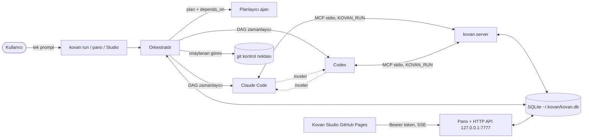

# 🐝 Kovan — Tek prompt, çok ajan

[](https://github.com/ramiz28615/new/actions/workflows/ci.yml)


**Canlı demo (Kovan Studio):** https://ramiz28615.github.io/new/

Tek bir cümle yazarsın; Kovan isteği **bağımlılıkları olan** görevlere böler, **Claude Code** ve **Codex**
ajanlarına dağıtır, ajanlar paralel çalışır, **birbirinin işini inceler**, onaylanan her görev git'e
kontrol noktası olarak işlenir ve sonuç tek klasörde, raporuyla birlikte teslim edilir.
Ajanlar ortak görev panosunu ve ortak hafızayı **MCP** üzerinden paylaşır.

## Kurulum (2 dakika)
```bash
# 1) Ajanlar (birini veya ikisini kur, giriş yap)
npm i -g @anthropic-ai/claude-code   && claude      # giriş
npm i -g @openai/codex               && codex login

# 2) Kovan
git clone https://github.com/ramiz28615/new kovan && cd kovan
pip install -e .            # geliştirici için: pip install -e ".[dev]"
kovan connect               # Claude Code + Codex'e MCP sunucusunu ekler
kovan doctor                # kontrol
```

## Kullanım
```bash
kovan run "Kafem için menü ve rezervasyon formu olan bir site yap, testlerini yaz" -d ./kafe
kovan run "deneme" --mock   # anahtarsız deneme (sahte ajanlar)
kovan dashboard             # http://127.0.0.1:7777 → token'lı hazır bağlantıyı yazdırır
kovan status [id]           # görevler, bağımlılıklar, görev başına maliyet
kovan cancel <id>           # çalışmayı iptal et (ajan süreçleri sonlandırılır)
kovan resume <id>           # bitmemiş görevleri yeniden çalıştır
kovan report [id]           # çalışma klasörüne REPORT.md yaz (--stdout: ekrana)
kovan diff <id> --task <t>  # görevin git değişiklikleri
kovan rollback <id> --task <t>   # görevin commit'ini geri al (git revert)
kovan config                # etkin yapılandırma
kovan token [--rotate]      # API token'ını göster / yenile
```

`kovan run` seçenekleri: `-b 3` (USD bütçe tavanı, 0 = sınırsız), `-w 4` (paralel ajan), `--planner codex`,
`--timeout 600` (ajan çağrısı başına sn), `--retries 2`, `--no-review`, `--no-git`,
`--yolo` (izin sormadan tam yetki, dikkatli kullan).

## Nasıl çalışır
1. **Planlayıcı** (Claude veya Codex) isteği 2–6 görevlik JSON plana çevirir. Her görev uygun ajana atanır ve
   `depends_on` ile hangi görevlerin önce bitmesi gerektiğini söyler. Döngüler tespit edilip kırılır.
2. **Zamanlayıcı (DAG):** Bağımlılıkları onaylanan görevler paralel başlar; başarısız bir görevin bağımlıları atlanır.
3. **İşçiler** MCP araçlarıyla ortak hafızayı okur/yazar, görev durumunu günceller. Geçici hatalar (rate limit, 5xx, ağ)
   üstel geri çekilmeyle yeniden denenir; her çağrının zaman aşımı vardır.
4. **Çapraz inceleme:** Claude'un işini Codex, Codex'in işini Claude inceler. `CHANGES` derse görev düzeltilir.
5. **Git kontrol noktası:** Onaylanan her görev `kovan: #id başlık` mesajıyla commit edilir (klasör depo değilse başlatılır).
6. **Bütçe:** Claude'un bildirdiği ve Codex'in token kullanımından tahmin edilen maliyet birlikte izlenir; tavan aşılınca
   yeni görev başlamaz, çalışma `budget` durumunda biter.
7. Her şey canlı panoda (SSE) görünür; `kovan report` her şeyi `REPORT.md`'ye döker.



## Güvenlik modeli
Pano API'si ajanları çalıştırabildiği için kilitlidir. Ayrıntılar: [SECURITY.md](SECURITY.md).

- Yalnızca `127.0.0.1`'e bağlanır; Host başlığı denetlenir (DNS rebinding koruması).
- `/api/health` dışındaki her uç nokta `Authorization: Bearer <token>` ister. Token ilk açılışta üretilir,
  `~/.kovan/token` (chmod 600) dosyasında durur ve `kovan dashboard` tarafından yazdırılır.
- CORS yalnızca `http://127.0.0.1:*`, `http://localhost:*` ve `https://ramiz28615.github.io` için açıktır
  (`KOVAN_ALLOWED_ORIGINS` ile değiştir).
- Web'den `yolo` yalnızca `kovan dashboard --allow-yolo` ile kabul edilir.
- Web'den açılan çalışmalar `~/kovan-projects` altında kalır; dosya okuma yol kaçışına kapalıdır; gövde 1 MB ile sınırlıdır.

### Kovan Studio ile bağlanmak
1. `kovan dashboard` çalıştır; çıktıdaki **token**'ı kopyala.
2. https://ramiz28615.github.io/new/ → **Motor** sekmesi → adres `http://127.0.0.1:7777`, token'ı yapıştır → **Bağlan**.
3. Ajan sekmesindeki çalıştırmalar artık gerçek ajanlarla yürür; canlı akış SSE ile gelir, **İptal et** düğmesi çalışmayı durdurur.

## HTTP API
| Yöntem | Yol | Açıklama |
|---|---|---|
| GET | `/api/health` | Sağlık (token gerekmez) |
| GET | `/api/state?run=` | Çalışma, görevler, olaylar, hafıza |
| GET | `/api/events?run=&after=` | Canlı olay akışı (`text/event-stream`), bitince `event: end` |
| GET | `/api/files?run=[&path=][&content=0]` | Çalışma klasöründeki dosyalar |
| GET | `/api/runs/<id>/report` | Markdown rapor (`?format=json` da olur) |
| GET | `/api/runs/<id>/tasks/<tid>/diff` | Görevin git diff'i |
| POST | `/api/run` | `{"prompt", "workdir", "budget", "workers", "mock", "planner", "review"}` |
| POST | `/api/runs/<id>/cancel` | İptal |
| POST | `/api/runs/<id>/resume` | Devam |

## Yapılandırma
`~/.kovan/config.toml` (yoksa varsayılanlar; `kovan config` etkin değerleri gösterir):
```toml
budget = 5.0            # USD, 0 = sınırsız
workers = 3
planner = "claude"
task_timeout = 900      # sn, ajan çağrısı başına
retries = 1             # geçici hatada yeniden deneme
retry_backoff = 2.0     # sn, her denemede ikiye katlanır
git_checkpoints = true
projects_root = "~/kovan-projects"
allowed_origins = ["http://127.0.0.1:*", "http://localhost:*", "https://ramiz28615.github.io"]

[prices.codex]          # USD / 1M token (Codex maliyet tahmini)
input = 1.25
output = 10.0
blended = 3.0           # yalnızca toplam token bilindiğinde
```
Ortam değişkenleri: `KOVAN_HOME` (varsayılan `~/.kovan`), `KOVAN_DB`, `KOVAN_PROJECTS_ROOT`,
`KOVAN_ALLOWED_ORIGINS`, `KOVAN_LOG_LEVEL`. Günlük: `~/.kovan/kovan.log` (JSON satırları).

## MCP araçları (her iki ajanda da)
| Araç | İş |
|---|---|
| `kovan_status` | Aktif çalışma ve görevler |
| `kovan_task_list` / `kovan_task_add` / `kovan_task_update` | Ortak görev panosu (`depends_on` destekli) |
| `kovan_memory_set` / `get` / `search` | Ajanlar arası ortak hafıza (çalışmaya özel; `global:` öneki tüm çalışmalarda ortak) |
| `kovan_review_submit` | Onay / düzeltme isteği |
| `kovan_log` | Panoya ilerleme notu |

Orkestratör her ajanı `KOVAN_RUN=<id>` ile başlatır; araçlar böylece "en son çalışma"yı değil, doğru çalışmayı hedefler.
`kovan connect` sonrası Claude Code veya Codex'i normal kullanırken de bu araçlar hazırdır
(örn. "kovan hafızasına global:api_adresi olarak API adresimizi kaydet").

## Mimari
```
kovan/
  server.py        MCP sunucusu (stdio, mcp 1.x/2.x uyumlu)
  orchestrator.py  plan → DAG zamanlayıcı → paralel işçiler → çapraz inceleme → kontrol noktası
  agents.py        claude -p / codex exec sarmalayıcıları (süreç grubu, iptal, zaman aşımı, maliyet)
  mock_agent.py    anahtarsız deneme için sahte ajan (ayrı süreç)
  dashboard.py     yerel HTTP API + SSE (stdlib); dashboard.html yerleşik pano
  security.py      token, CORS izin listesi, güvenli yol çözümü
  gitops.py        git kontrol noktaları, diff, geri alma
  report.py        REPORT.md üretimi
  config.py        config.toml + JSON günlükleme
  db.py            SQLite ortak durum ve şema göçü
  cli.py           kovan komutları
docs/              Kovan Studio (GitHub Pages)
```

## Docker
```bash
docker build -t kovan .
docker run --rm -p 127.0.0.1:7777:7777 -v kovan-data:/data -v "$PWD/projeler:/projects" kovan
```
İmajda `claude` / `codex` CLI'ları yoktur; gerçek ajanlar için bunları imaja eklemelisin, aksi hâlde yalnızca `--mock` çalışır.

## Geliştirme
```bash
pip install -e ".[dev]"
ruff check .
pytest
```

## Bilinen sınırlar
- Paralel görevler aynı klasörü paylaşır; bir görevin commit'i o anda çalışan başka bir görevin dosyalarını da
  içerebilir. Görev başına kesin ayrım için `-w 1` kullan.
- Codex maliyeti çıktıdaki token sayısından **tahmin** edilir; Codex sayıyı yazmazsa maliyet 0 görünür.
- Testler sahte ajanlarla çalışır; gerçek `claude` / `codex` CLI'larının çıktı biçimleri sürümle değişebilir.

## SaaS'a giden yol
- Panoya kullanıcı girişi + çok kiracılı Postgres
- Ajanları bulutta Docker kum havuzunda çalıştırma
- Şablon pazarı (hazır tek-prompt tarifleri) ve Stripe abonelik
- Uzak MCP (HTTP) ile kullanıcının kendi makinesine bağlanma

## Lisans
[MIT](LICENSE)
